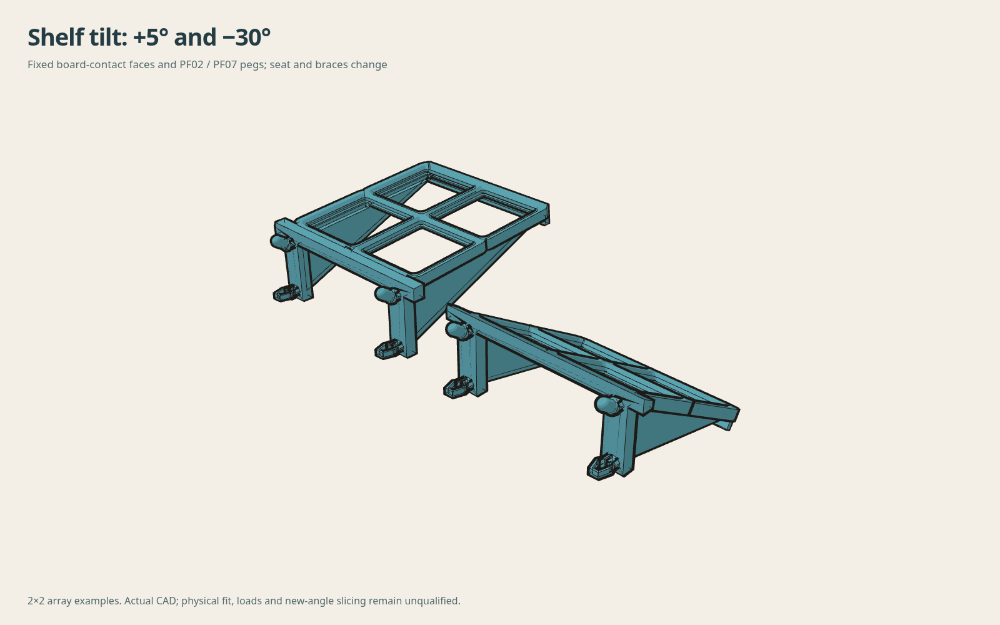

# Shelf generator geometry checks

[Native generator and parameter reference](../../source/gridfinity_generator_v1/README.md).

Seven cases cover 1×1, 2×1, 2×2, 4×1, tight/thick tuning, +5° and −30°.
Each is a valid native solid with zero STEP round-trip volume difference,
unchanged board-side pegs and complete 5.4 mm root blocks. Saved STLs have one
connected closed surface, paired edges, consistent winding and positive volume.
All print poses start at Z=0 within numerical tolerance.

The negative-clearance case reports deliberate reference-foot interference;
it does not claim seating at nominal height. Other cases have zero native
reference-foot overlap. The native checks cover the listed examples, not every
combination of parameters. Current source hashes are recorded with the results.

No generated tilted or multi-row shelf has a transferred load rating, physical
fit qualification or slicer approval. The original reviewed shelf files and
private ASA projects are unchanged. Browser/native mesh agreement and browser
interaction tests are separate from this native evidence.
