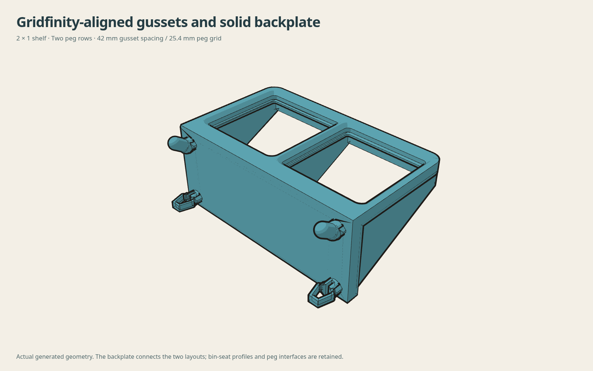
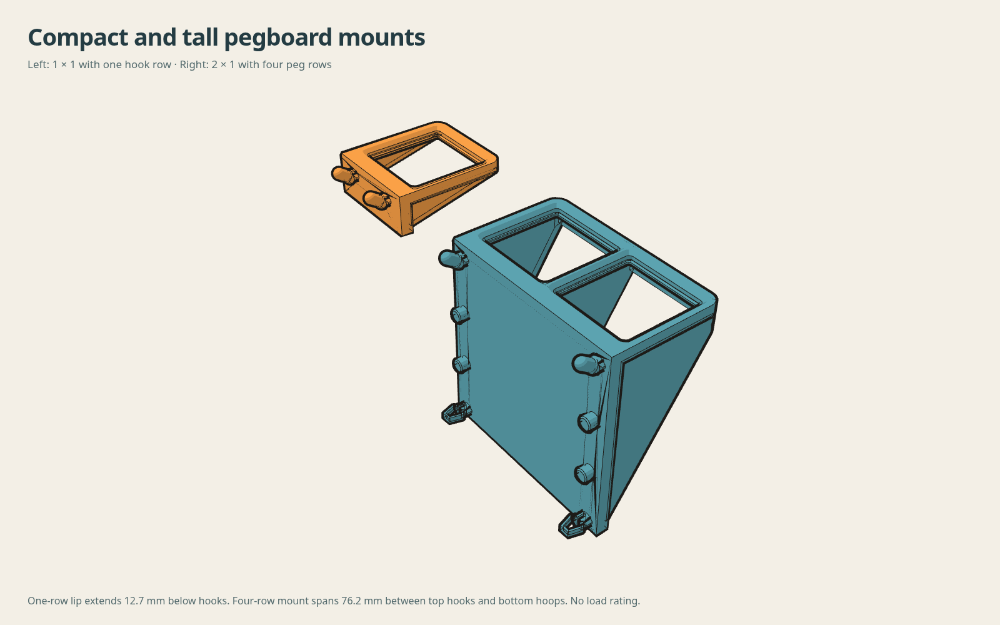
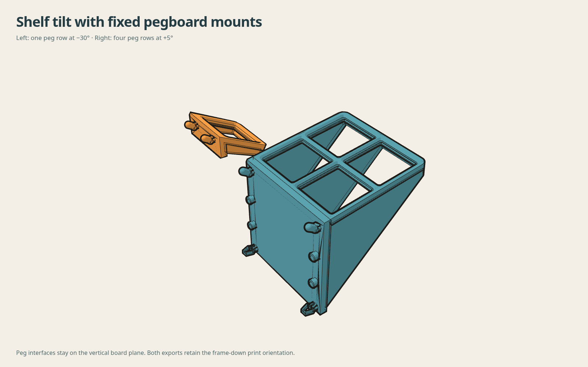

# Gridfinity generator with solid backplate

Default 2×1 shelf: 5.4 mm backplate, two mounting rows, three gussets aligned to the 42 mm Gridfinity boundaries. Board pegs retain 25.4 mm pitch. Mount height accepts one through four rows; the one-row option uses only hooks with a 12.7 mm lip below them. Larger heights retain bottom hoops with bearing locators between. An optional open back retains cross-ties and posts at both grids.

Nine native variants pass one-solid validity, STEP roundtrip, fixed board-side connector and root checks; eight nonnegative-clearance cases pass 13 lift poses per cell. Saved STL closure, winding, connected surface and bed minima pass. The tight variant intentionally permits reference-foot overlap. Browser volumes agree within 0.005%; three large array/angle cases pass their geometry gates. Browser controls, cancellation, downloads and mobile overflow checks pass.

Reproduce each entry of cases.json using the native generator and an existing FreeCAD Python runtime. An empty recipe generates the default case. Source: ../../source/gridfinity_generator_v1/. No new dependencies are required.

Taller mounting geometry is not a load rating or a transferred installation certificate. One-row mounts have no lower snap retention. The previous ASA slices do not cover these updated solids. Physical bin release, installation, support/toolpath and load checks remain required.
