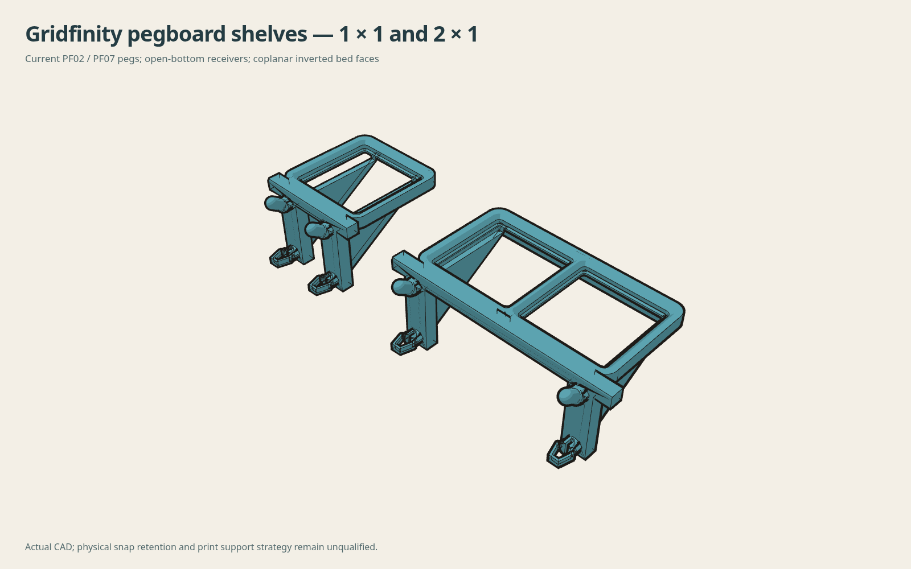
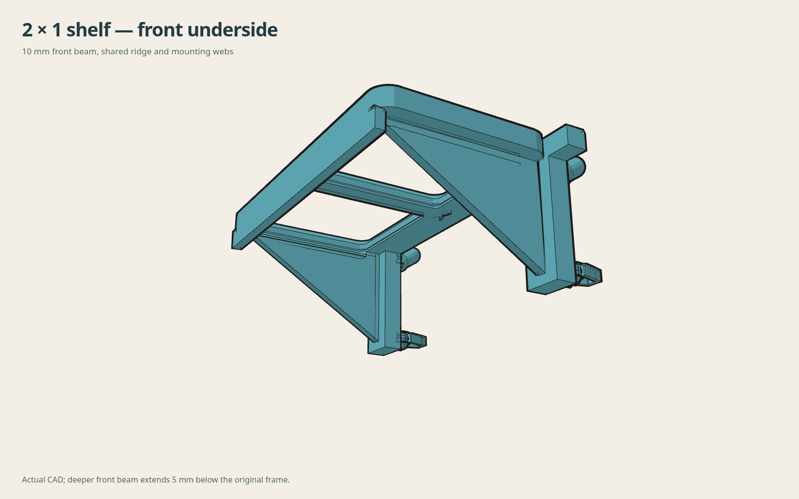
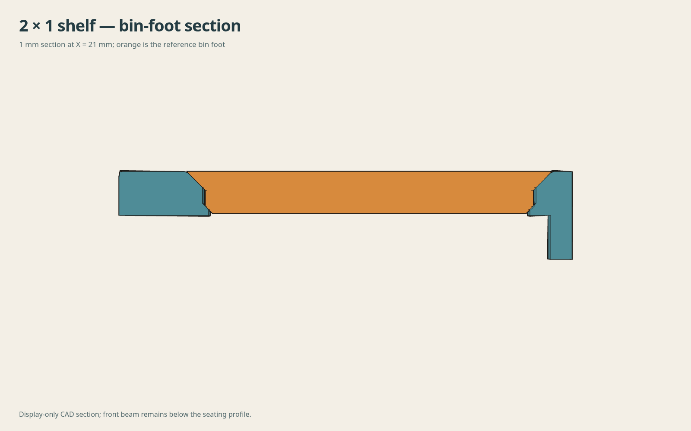
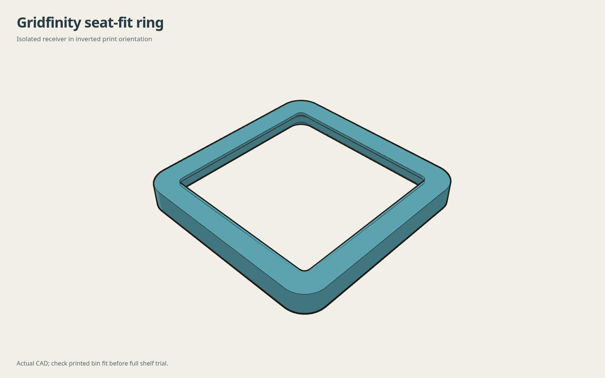

# Gridfinity shelf prototype review v1

[Build sources and dimensions](../../source/gridfinity_ultralight_v1/README.md).
The files in this directory describe the frozen 1×1 and 2×1 prototypes and
seat-fit ring. The STL identities are recorded in MESH-CHECKS.json.
Existing peg releases and the root nominal motion study are unchanged.

## Evidence

- CHECKS.json: native solids, STEP round trips, retained connector geometry,
  nominal host containment, bin first contact and analytical load comparisons.
- NATIVE-REOPEN-CHECKS.json: continuous root blocks and sampled bin withdrawal.
- BEAM-CONTINUITY.json: complete 76.2 × 1.9 × 10 mm front beam core.
- MESH-CHECKS.json: every saved STL has paired edges, consistent winding and
  positive volume; meshes were not repaired.

## Subsequent slice review

Separate private P1S 0.6 mm Polymaker ASA jobs were sliced and reopened at
0.20 mm layers, three walls, 20% rectilinear infill, 12 mm³/s maximum flow and
5,000 mm/s² acceleration. Supports and brim are off; normal ASA retraction is
retained. The inverted model orientation is preserved.

| Part | Estimated time | Estimated ASA |
|---|---:|---:|
| Seat-fit ring | 12 min 33 sec | 3.04 g |
| 1×1 shelf | 31 min 43 sec | 9.68 g |
| 2×1 shelf | 40 min 16 sec | 13.64 g |

All three first layers have one island. The ring has no bridge toolpaths;
the shelves have short bridge moves up to 4.14 mm. Peg overhang features remain
and require inspection on the physical print. These are slicer estimates and
checks, not demonstrated printing or load qualification. Printer jobs and
private profiles are deliberately excluded from this source review.

Print the ring first, then the 1×1, then the 2×1. Actual bin fit, complete
installation motion, hoop retention under straight-up and forward bin removal,
creep and usable load remain physical tests. The numerical load scenarios are
not load ratings.
